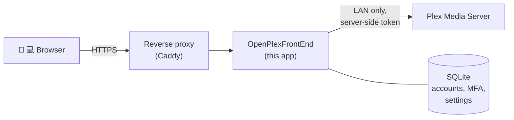

<div align="center">


# OpenPlexFrontEnd

**A self-hosted, Plezy-style web client for your Plex Media Server.**
Browse, play and watch Live TV in any modern browser, behind your own sign-in with passkeys or an authenticator app, while Plex itself stays on your LAN.

[](LICENSE)


[Features](#-features) · [How it works](#-how-it-works) · [Install](#-install) · [Using it](#-using-it) · [Development](#-development)

</div>

---

## ✨ Features

<table>
<tr>
<td width="50%" valign="top">

### 🎬 Browse

- Home hubs: **Continue Watching**, **Next Up**, **Recently Added** and Plex's recommendations
- Library grids with sort, filters and an A–Z jump bar
- Collections, video playlists, people, and search as you type
- Details pages with resolution, HDR and audio badges, multiple versions and extras

</td>
<td width="50%" valign="top">

### ▶️ Play

- **Direct play** when the browser can; otherwise Plex remuxes or transcodes
- Resume anywhere, quality and audio track switching, chapters and **scrub previews**
- Subtitles: SRT/VTT, **styled ASS/SSA** (libass) and **PGS** image subtitles
- **Skip intro/credits**, play queues with shuffle, **Up next** with autoplay
- File info explains how a file plays and why it's converted

</td>
</tr>
<tr>
<td width="50%" valign="top">

### 📺 Live TV

- Channel list with what's on now and **per-user favorites**
- A scrollable **program guide** and a **What's On** overview
- Watch with pause, a "behind live" indicator, **Go live** and channel up/down
- Tuners are released as soon as you stop watching

</td>
<td width="50%" valign="top">

### 🔐 Accounts & security

- Local accounts with **passkeys** or an **authenticator app** (TOTP), plus recovery codes
- Each user is mapped to a **Plex Home** user (own watch history and restrictions)
- Admin area with user management and an **audit log**
- Plex tokens never reach the browser; rate limits, account lockout, HSTS

</td>
</tr>
</table>

Works on phones and desktops, installs as an app (PWA), and supports keyboard control: see the [player guide](docs/player.md).

## 🧭 How it works



The app is the only thing exposed to the internet. It signs people in with its own accounts and two-factor authentication, and talks to Plex from the server side: browsing, images and media streams are all relayed, so the browser never sees a Plex token or your server's address. Watch state, progress and stream choices stay in Plex, so everything lines up with your other Plex apps.

## 🚀 Install

You need a host on the same network as Plex (ideally the Plex host itself), with **Docker** and **Docker Compose**, a **domain name**, and HTTPS in front of the app: either the bundled Caddy, or a reverse proxy you already run.

**1. DNS and router.** Point your domain (e.g. `plex.example.com`) at your public IP address, and forward ports 80 and 443 (TCP, plus UDP 443 for HTTP/3) to the host running the reverse proxy. Skip this if your existing proxy is already reachable.

**2. Configure.** Create `.env` from the example and fill it in:

```sh
cp .env.example .env
openssl rand -base64 32   # paste the output as APP_ENCRYPTION_KEY
```

| Variable             | Value                                                                                                     |
| -------------------- | --------------------------------------------------------------------------------------------------------- |
| `PUBLIC_ORIGIN`      | `https://` plus your domain, e.g. `https://plex.example.com`. Passkeys are tied to it, so choose it once. |
| `APP_ENCRYPTION_KEY` | The generated key. **Back it up**: see [Backups](docs/operations.md#backups).                             |
| `PLEX_URL`           | Your Plex server as the app reaches it, e.g. `http://192.168.1.10:32400`.                                 |
| `SITE_ADDRESS`       | Bundled Caddy only: your domain without `https://`.                                                       |
| `APP_PORT`           | Your own proxy only: the port the app listens on at `127.0.0.1` (default `3000`).                         |

> [!TIP]
> If Plex runs on the same host, add `COMPOSE_FILE=docker-compose.yml:docker-compose.host-network.yml` to `.env`. Plex then treats the app as a local client instead of a remote one, which matters for Plex's remote-streaming rules. Details in [operations](docs/operations.md#plex-sees-the-app-as-a-remote-client).

**3. Start.**

```sh
docker compose --profile caddy up -d --build   # with the bundled Caddy
docker compose up -d --build                   # or behind your own reverse proxy
```

Behind your own proxy, add a site that forwards to the app; there's a ready-made Caddy block in [operations](docs/operations.md#using-your-own-reverse-proxy).

**4. First run.**

1. Read the one-time setup token: `docker compose logs app | grep "setup token"`.
2. Open your domain, enter the token and create the administrator, then choose a password and set up a passkey or authenticator app.
3. **Link Plex:** under **Admin → Plex server**, choose **Connect** and approve the code at [plex.tv/link](https://plex.tv/link) as the server owner.
4. **Map users:** under **Admin → Users**, link each account (your own too) to a Plex Home user.

> [!IMPORTANT]
> Keep a copy of `APP_ENCRYPTION_KEY` somewhere safe, apart from your backups. Without it, stored authenticator secrets and Plex tokens can't be read.

## 📖 Using it

| Guide                                       | What's in it                                                                            |
| ------------------------------------------- | --------------------------------------------------------------------------------------- |
| [Player](docs/player.md)                    | Keyboard shortcuts, touch gestures, subtitles, skipping, autoplay and queues, file info |
| [Signing in and security](docs/security.md) | Passkeys, authenticator apps, recovery codes, account recovery, what admins can see     |
| [Operations](docs/operations.md)            | Configuration, reverse proxies, backups and restore, upgrades, the admin CLI, fail2ban  |

<details>
<summary><b>⌨️ Player shortcuts at a glance</b></summary>

| Key           | Action                    |
| ------------- | ------------------------- |
| `Space` / `k` | Play or pause             |
| `←` / `→`     | Back / forward 10 seconds |
| `↑` / `↓`     | Volume                    |
| `m` / `f`     | Mute / full screen        |
| `[` / `]`     | Slower / faster           |
| `c`           | Subtitles on or off       |
| `i`           | File info                 |

</details>

## 🛠️ Development

<details>
<summary><b>Run it locally</b></summary>

Requires **Node.js 22.17** or later.

```sh
npm install
cp .env.example .env          # set PUBLIC_ORIGIN=http://localhost:5173 and a key
npm run dev
```

| Command                    | What it does                                                                 |
| -------------------------- | ---------------------------------------------------------------------------- |
| `npm run check`            | Type-checks the app                                                          |
| `npm run lint`             | Prettier and ESLint                                                          |
| `npm test`                 | Unit and component tests (Vitest)                                            |
| `npm run test:e2e:chunked` | End-to-end tests (Playwright, Chromium and WebKit) in memory-friendly chunks |
| `npm run fake-pms`         | Starts the fake Plex server the tests use                                    |
| `npm run fixtures:record`  | Records test fixtures from your own Plex server (`PLEX_URL=… PLEX_TOKEN=…`)  |

The tests run against a fake Plex server that serves responses recorded from a real one. These recordings aren't included, because they contain a personal library: record your own with `npm run fixtures:record`, and expect to adapt assertions that refer to specific titles.

</details>

<details>
<summary><b>Built with</b></summary>

[SvelteKit](https://svelte.dev) and Svelte 5 · [Tailwind CSS](https://tailwindcss.com) · [Drizzle ORM](https://orm.drizzle.team) on SQLite · [SimpleWebAuthn](https://simplewebauthn.dev) · [hls.js](https://github.com/video-dev/hls.js) · [JASSUB](https://github.com/ThaUnknown/jassub) (libass) · [libpgs](https://github.com/Arcus92/libpgs-js) · [Vitest](https://vitest.dev) and [Playwright](https://playwright.dev)

</details>

## 🙏 Acknowledgements

Inspired by [Plezy](https://github.com/edde746/plezy), an open-source Plex client. OpenPlexFrontEnd isn't affiliated with or endorsed by Plex, Inc.

## 📄 License

[GPL-3.0-or-later](LICENSE).
